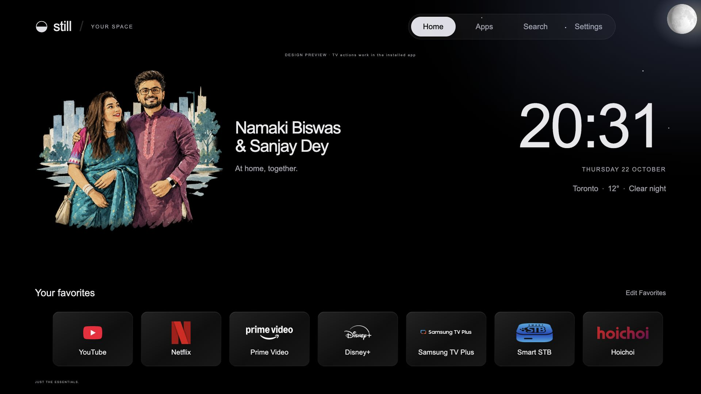
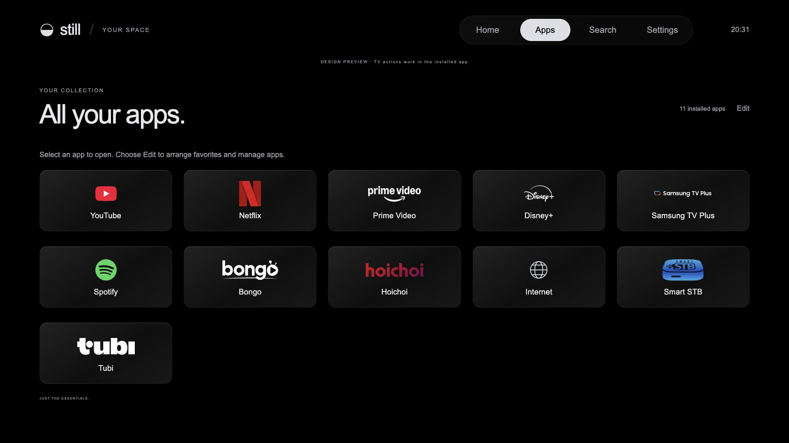
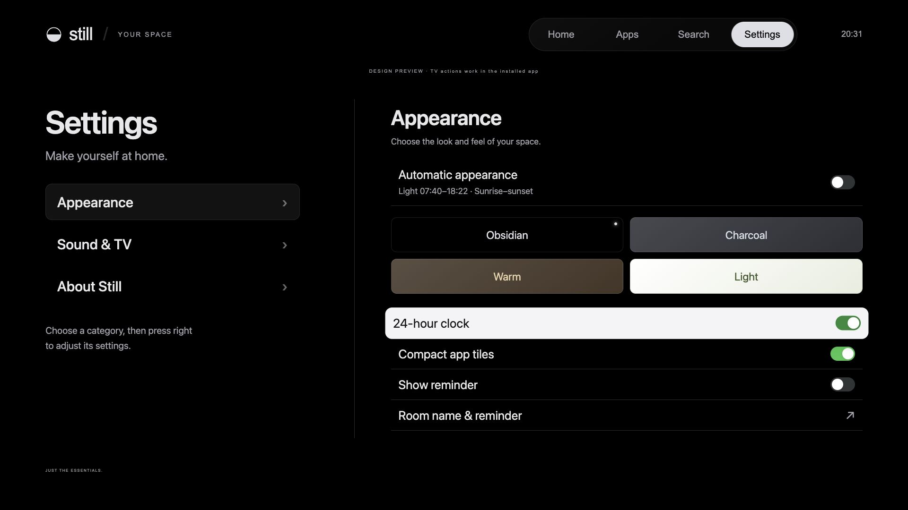
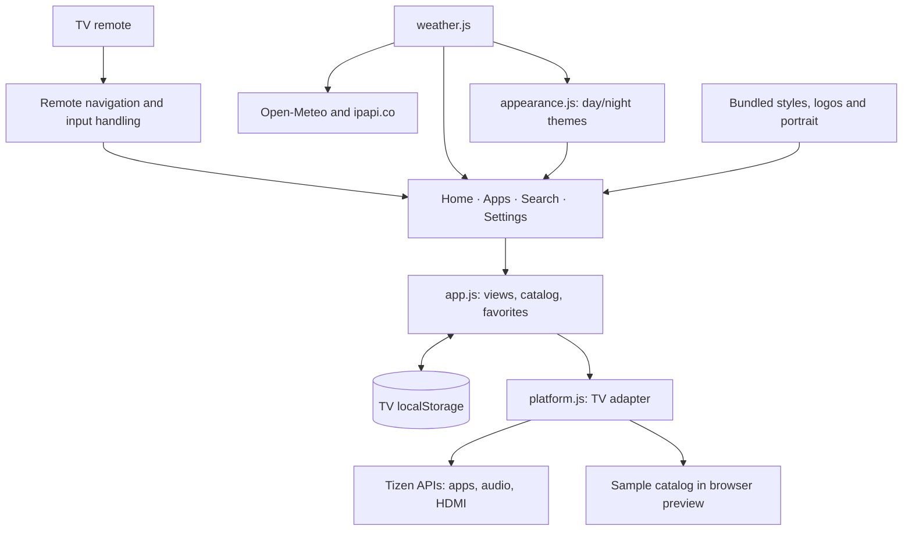

# Still · Samsung TV dashboard

A personal, remote-friendly home screen for Samsung Tizen TVs. Still brings favorite apps, local weather, a clock, and TV controls into a calm interface built with plain HTML, CSS, and JavaScript.

**Current version: 1.9.34** · Installed and launched on a Samsung QN65S85FAFXZC · Tizen 6.0+ required by the manifest

## Screenshots

Browser previews in Obsidian mode at 1920 × 1080. App inventory is sample data; the Home capture shows live Toronto weather. These are interface previews, not photographs of the TV.







## Features

- Home screen with a personal portrait, clock, reminder, and favorite apps.
- App discovery, search, launch, and favorite ordering on the TV.
- Remote arrow navigation with eased horizontal scrolling and selection zoom.
- Edit mode to pin, reorder, and hide apps from Home and search.
- Light and dark themes, automatic day/night appearance, and reduced-motion support.
- Local weather, city search, weather scenes, and sunrise/sunset appearance timing.
- HDMI selection, volume/mute controls, and shortcuts to native TV panels where supported.
- Preferences saved locally on the TV.

## Architecture

The installed app runs directly on the TV. Its UI assets are bundled in the signed widget; a Mac server is not required at runtime. Internet access supplies weather and location data.



- **Application:** `app.js` owns views, preferences, app catalog filtering, search, and editing. Hidden views render lazily; unchanged discovery results preserve focus and shelf position.
- **Platform:** `platform.js` wraps public Tizen application, audio, system information, and TV window APIs. It supplies sample app entries when running in a desktop browser.
- **Navigation:** `remote.js` normalizes Samsung keys, handles native text editing, and reveals focused items. `navigation.js` animates the top navigation selection; `focus.js` contains a separate focus-frame implementation and is currently not loaded by the entry page.
- **Presentation:** `style.css`, `logos.js`, and `layout.js` provide themes, app artwork, focus treatments, and viewport sizing.
- **Weather:** `weather.js` handles location, forecasts, cached data, and weather scenes; `appearance.js` selects manual or automatic themes.

## Run a browser preview

Requires Python 3. Run from the repository root:

```sh
python3 -m http.server 8766 --bind 127.0.0.1 --directory dashboard/tizen
```

Open [localhost:8766](http://localhost:8766). Use arrow keys to navigate and Enter to select. TV app launch, HDMI, and audio controls require the installed TV app.

## Test

Requires Node.js with the built-in test runner. No npm install is needed for the regression suite.

```sh
node --test dashboard/tests/*.test.cjs
```

The current suite contains 61 tests covering app discovery, edit mode, remote/IME input, scrolling, audio, HDMI, themes, weather, artwork, and rendering behavior. Optional browser weather checks in `dashboard/tools/check-weather.cjs` additionally require Playwright and Chrome.

## Install on a Samsung TV

1. Install Tizen Studio, Samsung TV extensions, and Samsung certificate tools.
2. Enable Developer Mode on the TV and configure the development computer address.
3. Create a signing profile with a distributor certificate that includes your TV's DUID.
4. Package `dashboard/tizen/` as a signed `.wgt`, connect to the TV with SDB, and install it with your Samsung TV tooling.
5. Launch application `StillHome1.Dashboard` (package `StillHome1`).

This repository excludes the SDK, signed packages, signing certificates, and pairing credentials. Existing-device updates used Samsung's direct `vd_appinstall` path; the SDK's `tz install` previously uninstalled/reinstalled the app and reset its local data. See the [device notes and release history](dashboard/tizen/README.md) for the project's tested setup and limitations.

Still is an installed application. Experimental native startup configuration used on the development TV is separate from installing this widget and is not included as an automated setup here.

## Repository layout

```text
 dashboard/
   tizen/          Current native TV app and bundled assets
   tests/          Node.js regression tests
   tools/          Weather assets and browser verification tools
   weather-check/  Weather verification results
   dist/           Earlier browser dashboard
   server.py       Optional legacy Python remote bridge
 docs/screenshots/ Current browser preview captures
 samsung_tv.py     Optional legacy TV pairing/remote client
```

The earlier server in `dashboard/server.py` serves `dashboard/dist/`, not the current Tizen UI. Its pairing token stays in the ignored `.tv-connection.json` file.

## Artwork and customization

The welcome names and portrait are personalized in `dashboard/tizen/index.html` and `dashboard/tizen/images/home-portrait.png`. App artwork provenance is documented in [SOURCES.md](dashboard/tizen/icons/official/SOURCES.md). Third-party names and logos belong to their respective owners.
